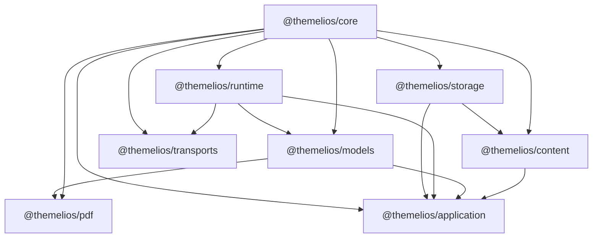

# 架构与包职责

Themelios 使用 TypeScript 7 与 Bun 1.4+ 构建，按清晰的单向依赖边界拆分为 7 个核心公共包与领域扩展包：

## 包职责表

| 包 | 拥有能力 | 关键入口与说明 |
| --- | --- | --- |
| `@themelios/core` | JSON 边界校验、`ArtifactRef` 与 60 位 `readable60`、选区、时间原语、`AppError`、`Completed`/`SavedResult`、`CallOptions`/`Flow` | 零外部运行时状态依赖，所有包共用基础值类型 |
| `@themelios/runtime` | 安装、会话、实例锁、配置、网络、诊断和通用操作契约 | `@themelios/runtime/operations` 定义宿主操作、权限和执行校验 |
| `@themelios/storage` | `Database`（同步短事务、提交切面 `seq`、`commits`、`time_domains`）、`Cas` 内容寻址存储、备份恢复、回收与校验 | 使用 `bun:sqlite` 与 `write-file-atomic`，统一持久化与恢复原语 |
| `@themelios/content` | `Materials`、`Results`、`Representations`、文本选区、Markdown 结构分块、图像朝正与编码适配器 `createImageAdapter` | 协调 `artifacts`、`artifact_edges`、`artifact_roots`、`representations` |
| `@themelios/models` | 厂商中立模型网关连接与显式能力绑定、`createPrompts` Liquid 模板编译与缓存、`createPreparation`、独立 `models.runTask` 与 `createTasks` | 可脱离存储与实例单独嵌入使用 |
| `@themelios/application` | `createApplicationModule`、`ApplicationApi`、内容与模型任务操作 | 组合会话、内容与模型，供完整应用和工作台使用 |
| `@themelios/transports` | 将显式提供的操作目录开放为 HTTP/SSE、MCP 和 CLI | 依赖 Runtime 与 Core。宿主提供业务对象和开放的操作 |
| `@themelios/pdf` | PDF 页范围抽取、文本提取与光栅化渲染适配器（`createPdfAdapters`） | 作为 `RepresentationAdapter[]` 在应用装配时注入 |

## 独立嵌入与完整应用

- **轻量嵌入**：只需要结构化模型调用与本地多模态输入准备时，应用可直接只安装 `@themelios/models`（及其传递依赖 `@themelios/core`、`@themelios/runtime`、`zod`），通过 `createModels` 与 `models.runTask` 直接执行内联或文件模板任务，无需创建实例或数据库。
- **自定义业务应用**：业务方直接使用 `@themelios/core`、`@themelios/runtime`、`@themelios/storage`、`@themelios/content`、`@themelios/application` 与 `@themelios/transports`（例如 `examples/inventory`），用 `defineOperation` 描述领域操作并组合 `instanceOperations()`，即可复用同一套实例锁、配置重载、CLI、HTTP 与 MCP 传输。
- **完整文档工作台**：`apps/workbench` 使用 `createApplicationModule`、`@themelios/pdf` 与 `standardOperations`，提供材料管理、任务执行、提示词覆盖与离线维护的完整可执行发行物。
