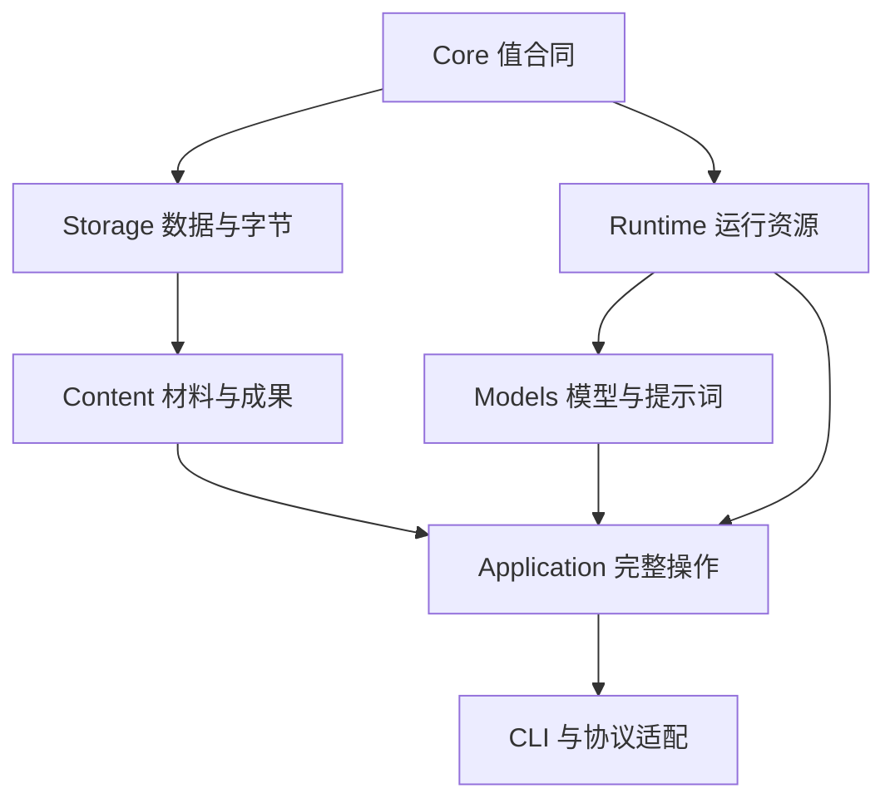

# Themelios 提供可独立交付的通用基础能力

本次建设一个独立的 TypeScript/Bun 平台：普通应用可以按需使用配置、诊断、存储、材料、模型和提示词，也可以打开完整安装实例，通过 SDK、CLI、HTTP、MCP 或 gRPC 使用同一组操作。完成点是正式包可被外部项目安装、Portable 可搬迁运行，以及两个与 Nous 认知业务无关的应用能够完成实际工作。

## 三个仓库分别拥有平台、算法和认知业务

| 仓库 | 本身拥有的决定与数据 | 与本期的关系 |
| --- | --- | --- |
| Themelios | 安装与运行、配置与凭据、错误和诊断、网络、SQLite/CAS、材料与成果、通用时间、模型与 Prompt、输入准备、协议适配、发行 | 本执行包的全部施工范围 |
| Nexus | VCP/Wave 数学与数值算子、计算索引、Rust crate、对应 napi 绑定 | 后续独立项目；Themelios 提供通用 Native 发行方法 |
| Nous | 认知对象、NousQL、认知五轴、检索语义和业务编排 | 后续消费者；本期完成后停止，等待新的业务任务 |

未来 Nous 用 Git submodule 固定两个依赖仓的源码提交。每个仓库维护自己的 workspace、catalog、锁文件和版本；构建后的 npm 包通过 `exports` 消费。源码固定与包接口是不同责任，submodule 路径不会成为跨仓私有导入入口。

用户已在本机初始化 Themelios 工作区和 Agent 工具链。本文给出的路径是职责落点；实现者先对应现有目录，再补能力。已经正确的环境、脚本和规则直接使用。当前规格编写环境未取得该本机工作树，本文中的目标目录与 API 是本次设计决定。

## 七个包沿实际能力单向依赖

| 包 | 对外承担的完整操作 | 允许依赖 |
| --- | --- | --- |
| `@themelios/core` | JSON/选区/完成值/错误/取消与通用时间值合同 | Zod 与必要标准实现 |
| `@themelios/runtime` | Installation/Instance/Session 的宿主机制、配置、凭据、网络、诊断、资源关闭、通用文件锁 | core |
| `@themelios/storage` | SQLite 短事务、提交切面、CAS、备份、维护、通用时间域保存 | core |
| `@themelios/content` | 材料接纳/读取/结构/来源、结果保存与读取、确定性表示管理 | core、storage |
| `@themelios/models` | 模型资源、生成/向量/重排/转写、任务 Schema、Prompt 编辑与预览 | core；runtime 的网络和诊断公开子入口 |
| `@themelios/application` | 装配具体能力；输入准备；任务执行与显式保存；操作目录 | 上述五包 |
| `@themelios/transports` | 同一操作目录的 CLI、HTTP、MCP、gRPC 编解码与连接生命周期 | core、application、runtime 的公开入口 |

Models 只导入所需的网络/诊断子入口，加载它不会打开数据库、实例锁或 Native 模块。Content 读取原件只做确定性工作；生成图片描述或音频转写由 Application 中的显式任务调用 Models。这样读取与推理保持单向依赖。

## 对象绑定长期上下文，参数只表达本次请求

完整使用路径是 `Installation.at(root, application)` → `installation.instance(name)` → `instance.init()` / `instance.open()` → `session.api` → `session.close()`。安装拥有程序和资源位置，实例拥有稳定数据目录，会话拥有本次打开的资源，API 直接提供材料、结果、任务及配置操作。

模块也各自成立：`createModels(...)` 能在普通脚本里执行一次任务；`createPrompts(...)` 能在编辑器工具里渲染模板；`Cas.open(path)` 能独立保存字节；`Database.open(...)` 能服务普通业务表。应用自己组合所需模块，通过构造参数传入少数真实依赖。

每项操作只有一个业务所有者。适配器解释参数和协议、取得调用身份，然后调用 Application；材料操作内部完成验证、字节处理和事务。调用方直接获得可消费的完成值，保存由明确的 `results.save(completed)` 或 `tasks.run({...request, persist:true})` 请求触发。

## 目录围绕所有者组织

| 目标位置 | 所有内容 |
| --- | --- |
| `packages/core/src/` | `json.ts`、`selection.ts`、`completion.ts`、`errors.ts`、`flow.ts`、`time.ts` |
| `packages/runtime/src/` | 安装布局、会话、配置定义/快照/更新、网络、凭据、诊断、本地化、Native loader |
| `native/runtime/` | 使用 Rust 标准库的文件锁 N-API 接缝 |
| `packages/storage/src/` | `database.ts`、`cas.ts`、`maintenance.ts`、`backup.ts`、`time-domains.ts` |
| `packages/content/src/` | `schema.ts`、`materials.ts`、`results.ts`、`representations.ts`、`text-structure.ts` |
| `packages/models/src/` | `models.ts`、`providers/`、`tasks.ts`、`prompts.ts`、`schema.ts` |
| `packages/application/src/` | `application.ts`、`operations.ts`、`inputs.ts`、`preparation.ts`、`tasks.ts` |
| `packages/transports/src/` | `cli/`、`http/`、`mcp/`、`grpc/`、共同 wire 编解码 |
| `extensions/pdf/` | PDF.js 确定性提取和按页渲染的第一方扩展 |
| `apps/workbench/` | 文档整理工作台 CLI 与服务启动入口、内置任务和资源 |
| `examples/embedded/` | 脱离完整实例的 Models/Prompt 使用 |
| `examples/inventory/` | 与 Nous 无关的结构化资料登记应用 |
| `resources/`、`scripts/` | 内置资源；现有构建/文档/发行命令的实现 |

文件可按实现内聚性合并或拆开。包边界、语义所有者、事务责任、公共方法及行为保持本文定义；不以文件名本身建立新的兼容义务。

## 本期产品能力有明确的深度

核心能力完整实现：本地实例的创建与打开、配置查询修改、错误诊断、HTTP 网络、SQLite/CAS、文本和图像、保存与追溯、模型生成与结构输出、嵌入/重排/转写连接合同、任务和 Prompt 开发体验、四种入口、备份恢复、通用时间域、包和 Portable。

PDF 作为真实扩展，接通文本提取及需要时的页图像路线。音视频通过正式媒体能力、原生模型输入和扩展配方合同接入；外部转换工具按启用的扩展提供。模型提供者按实际能力声明工作，缺少所需能力时给出具体受影响的材料与配置项。

长期保存的事实包括原件、正式结果、来源关系、显式选定的表示和提交顺序。运行中的排队、流、进度、临时媒体和连接属于当前调用/会话；程序重启后可以读取完成成果，新调用处理未完成计算。

## 完成平台后交付给独立消费者

实施计划见 [implementation.md](../plan/implementation.md)，行为验收见 [verification.md](../plan/verification.md)。最终交付正式包 tarball、Windows 与 Ubuntu Portable、可运行示例、使用说明及真实外部模型调用记录。发行产物留在本地供使用；npm/GitHub 的公开发布由明确的发布任务处理。

设计依据来自用户 2026-11-17 的原始讨论与 handoff；与本期有关的长期产品边界见 [项目宪纲](https://github.com/Heptalogos-Devs/Architecture-Vault/blob/main/项目宪纲.md)。本期以已确定的三仓职责为执行范围。
